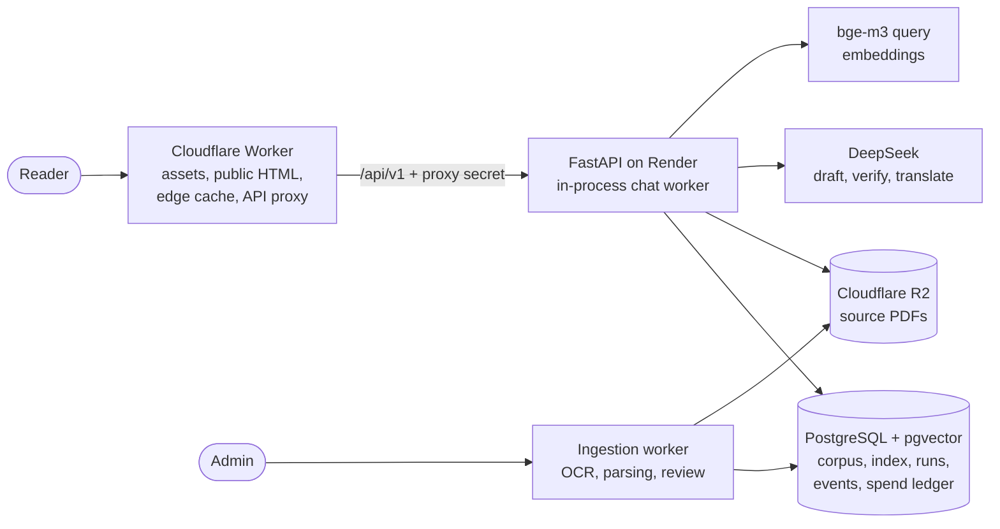

<p></p>

# constitution.ng

constitution.ng answers plain-language questions about Nigerian law (the 1999
Constitution and federal statutes) from a published, versioned corpus. Every
answer block cites stored provisions, citations are generated by the server, and
an answer that cannot be tied to its evidence is withheld. The product was
previously called Law Padi; some folder names and identifiers still carry that
name.

## What it does

- **Ask a question** in English, Nigerian Pidgin, Yorùbá, Hausa or Igbo. The
  answer explains the relevant provisions in plain English (or the reader's
  language, labelled Beta) with the conditions that change it, and shows the
  source wording beside it.
- **Look up a citation** such as "Section 35(4)" or "ACJA s.9" and get the
  stored text, its ancestry, the source PDF page and the edition it comes from.
  Exact lookup needs no model and no embeddings.
- **Browse and bookmark** laws by structure. Links can be pinned to a release, so
  they keep pointing at the wording they were made on.
- **Read honest editions.** The Constitution text is a historical source
  compilation and Acts are as enacted; answers carry an edition notice for each
  law they cite, and answers that call historical text current law are rejected.

## Architecture



**A question, end to end.** `api/routes/conversations.py` admits the question
against per-reader limits and a global cap, stores a `GenerationRun` pinned to
the conversation's corpus release, and wakes the worker in
`chat/worker.py`. If the question is not clearly English, one call in
`chat/translation.py` returns its language and an English rendering. `prepare_run`
then resolves exact references with `legal/references.py`, or runs
`semantic_lookup` in `legal/evidence.py`, which fuses dense pgvector search,
PostgreSQL full-text search and the hand-curated topic guide (`legal/topics.py`)
with reciprocal-rank fusion in `ingestion/pgvector_repository.py`. Results are
reloaded from canonical `ProvisionVersion` rows and their text hashes are
re-checked. The evidence packet goes to the drafting model; the draft must cite
evidence IDs on every block and passes deterministic checks in
`chat/validation.py` and then a separate model verifier. Every paid call is
reserved and settled in `chat/budget.py`. Only a validated answer is published;
for a non-English reader it is then translated, checked and, for Yorùbá, Hausa
and Igbo, judged by back-translation, falling back to English on any failure.
Events are persisted before `pg_notify` and streamed over SSE with
`Last-Event-ID` replay. All paths are under `backend/app/`.

The full design, including the data model and the ingestion pipeline, is in
[`docs/architecture.md`](docs/architecture.md).

## Engineering decisions

- [PostgreSQL and pgvector for retrieval](docs/adr/0001-postgres-pgvector-retrieval.md):
  publication and rollback are one transaction; no separate vector store to keep
  in step.
- [Evidence boundary, server-built citations, fail-closed validation](docs/adr/0002-evidence-boundary-and-server-citations.md):
  fewer unsupported answers reach readers, at the cost of more withheld answers.
- [English core, translated edges](docs/adr/0003-english-core-translated-edges.md):
  one retrieval and validation path for five languages; translation quality is
  still unreviewed.
- [Immutable, release-pinned corpus](docs/adr/0004-release-pinned-corpus.md):
  answers and bookmarks keep their wording across releases; old releases stay
  stored.
- [Render, Cloudflare Worker and Neon instead of Cloud Run](docs/adr/0005-render-cloudflare-neon-hosting.md):
  no hosting cost within free allowances; cold starts and one generation at a
  time.
- [Reserve-then-settle spend ledger](docs/adr/0006-reserve-then-settle-spend-ledger.md):
  budgets hold under concurrency and provider timeouts; uncertain charges stay
  counted.

## Evaluation

Retrieval is measured at section level. Development sets were used to build the
topic guide; held-out sets were not. Sources and caveats are in
[`docs/evaluation.md`](docs/evaluation.md).

| Set | Measure | Result | Source |
| --- | --- | --- | --- |
| Constitution development set, 57 questions | Fused hit@1 before and after the topic guide | 0.82 to 0.98 | `eval/datasets/plain-language-retrieval-benchmark-v1.json`, `baseline_2026_10_12` |
| Constitution held-out set, 40 questions | Fused hit@1 (hit@5) before and after section-title scoring | 0.82 (0.95) to 0.95 (1.00) | `eval/datasets/plain-language-retrieval-heldout-v1.json`, `results_2026_10_17` |
| Three-law held-out set, 40 questions | Expected section first, before and after fixes | 21 to 21 of 40 | [`docs/search-quality-comparison-2026-10-29.md`](docs/search-quality-comparison-2026-10-29.md) |
| Three-law held-out set, 40 questions | Expected section in top 5 | 35 to 36 of 40 | same |
| 100 questions, deployed prompt and model, model-graded | Returned an explanation; mean accuracy 0 to 2 | 87 of 100; 1.76 | same |
| 200-case answer set, human review | At least 95% supported answers | Not met: human review not done | [`docs/evidence-chat-rollout.md`](docs/evidence-chat-rollout.md) |

What the numbers mean:

- The development-set gain shows the topic guide fits the questions it was
  written for. The held-out improvement was adopted with the held-out results
  visible, and the three-law held-out set shows no gain from the same kind of
  work. The honest summary is that retrieval is strong on phrasing the guide
  covers and unproven on phrasing it does not.
- **No retrieval or answer metric is gated in CI.** CI runs the backend tests
  (real PostgreSQL, a fake model at the provider boundary, 88% coverage floor),
  lint, type checks, Worker tests and an image smoke test. Benchmarks need a
  live database and the embedding endpoint and are run by hand.
- Public generation is enabled although the 200-case human review gate is not
  met. That is recorded as a dated
  [launch exception](docs/evidence-chat-rollout.md#launch-exception-recorded-16-november-2026)
  with the safeguards in force and what would close it.

## Limitations

- **Editions, not current law.** The Constitution text is the LFN 2004 source
  compilation, without later alterations; Acts are as enacted. An accurate
  explanation of the stored text can differ from the law today.
- **Source gaps.** Section 168 is missing from the Constitution source and two
  provisions are printed as Section 189; both are kept as found. State laws,
  case law and amendment instruments are not ingested.
- **Unreviewed languages.** Glossaries, translated benchmarks and interface text
  for Pidgin, Yorùbá, Hausa and Igbo have had no native-speaker review.
- **Capacity.** Production allows one generation at a time; while an answer is
  generating, another reader's question is refused with HTTP 429. Free hosting
  sleeps when idle, so the first request after a pause is slow.
- **No human-reviewed answer quality** for the deployed prompt and model (see
  Evaluation).
- **Hand-curated retrieval.** The topic guide is a large hand-written map, and
  its coverage is uneven across laws.

## Running locally

Requirements: Docker, [uv](https://docs.astral.sh/uv/) (Python 3.14) and
[Bun](https://bun.sh/).

```bash
cp .env.example .env
cp frontend/.env.example frontend/.env
docker compose up -d db mailpit

cd backend
uv sync
uv run bash scripts/prestart.sh   # migrate and create the first superuser from .env
uv run fastapi dev                # API on http://localhost:8000 (docs at /docs)

# in a second terminal, from the repository root
bun install
bun run dev                       # frontend on http://localhost:5173
```

A fresh database has no published law, and the source PDFs are not in this
repository. Lookup, search and chat need a corpus release ingested through the
admin workspace with the ingestion worker
([`docs/runbooks/ingestion.md`](docs/runbooks/ingestion.md)). Chat also needs a
`DEEPSEEK_API_KEY` and a chat worker; see [`docs/development.md`](docs/development.md).

Checks:

```bash
bun run lint                                  # Biome, check only (bun run lint:fix to apply fixes)
bun run build                                 # type-check and build the frontend
cd backend && uv run bash scripts/lint.sh     # mypy, ty and Ruff
cd backend && uv run bash scripts/test.sh     # Pytest on a database ending in _test
bun run test                                  # Playwright against the Compose stack
```

## Repository map

| Path | Contents |
| --- | --- |
| `backend/` | FastAPI app: legal domain, retrieval, chat, ingestion, migrations, tests, operator scripts |
| `frontend/` | React and TypeScript client |
| `services/ingestion-worker/` | Worker image with Poppler and Tesseract for PDF rendering and OCR |
| `packages/react-email/` | Email template sources |
| `deployment/` | Render image and backups, Cloudflare Worker, release copy script |
| `eval/datasets/` | Retrieval and answer evaluation datasets ([`eval/README.md`](eval/README.md)) |
| `docs/` | Architecture, decision records, evaluation, runbooks, plans ([`docs/README.md`](docs/README.md)) |
| `brand/` | Logo and icons with usage guidelines |
| `scripts/` | Build revision, client generation, image smoke test |
| `compose*.yml`, `render.yaml` | Local and self-hosted stack; production service settings |

## Deployment

Production is one Render free web service (API and chat worker in one process),
a Cloudflare Worker in front of it, Neon PostgreSQL and private R2.
`render.yaml` holds every production setting and deploys each commit on
`master`. Corpus releases are built and reviewed locally, then copied and
activated with `deployment/publish_release.py`. Runbooks:
[Render](docs/runbooks/render.md), [releases](docs/runbooks/release.md),
[backups](docs/runbooks/backup-restore.md),
[Cloudflare](deployment/cloudflare/README.md).

## What was inherited and what was built

The repository started from the MIT-licensed
[full-stack-fastapi-template](https://github.com/fastapi/full-stack-fastapi-template)
(the first commit is the template). Inherited: the project layout, the `User`
model with password hashing, JWT login and password recovery, the Docker Compose
stack with Traefik, Adminer and Mailpit, the React scaffold with a generated
OpenAPI client, the React Email setup, Playwright and pre-commit tooling.

Built for this product: the legal data model and parsers, the ingestion and
review pipeline, pgvector retrieval with the topic guide and fusion, releases
and composition, the chat pipeline with validation, verification, translation,
the spend ledger and durable SSE, rotating refresh-token sessions, the
evaluation datasets and scripts, the frontend product screens, the Cloudflare
Worker and the Render deployment.

## Legal texts and sources

This repository contains code, evaluation datasets (questions with expected
section identifiers) and per-law section-title catalogues in
`backend/app/legal/data/`. It does not contain the legal corpus or the source
PDFs; those live in the production database and object storage. The sources
are copies published by government bodies and by secondary publishers; each
source document records its publisher, URL and tier (`official` or
`trusted_secondary`), and the section-title catalogues record the URL of the
copy they were taken from. The licence basis for reproducing each source's text
has not been reviewed and is an open item. Nothing here is legal advice.

## Licence

Code is released under the [MIT licence](LICENSE), which keeps the template
author's copyright notice alongside the project's. The licence applies to this
repository's contents; it grants nothing over the legal texts, which are not
included. Whether the constitution.ng name, logo and brand assets in `brand/`
should be licensed separately is an open item.
