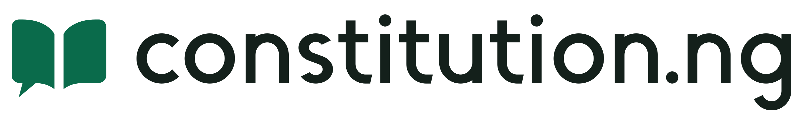

# constitution.ng — Logo guidelines

## 1. The logo

**Idea:** the Constitution as an open book that talks back. One page ends in a speech-bubble tail: you can read
the law, and ask it questions. In colour, the two green pages and the white gutter between them echo the flag,
and the white gap above the gutter forms the Y where the Niger and Benue meet.

| Version | File | Use it for |
|---|---|---|
| Horizontal (primary) | `logo/constitution-ng-horizontal.svg` | Site header, documents, most uses |
| Stacked | `logo/constitution-ng-stacked.svg` | Square spaces: social cards, posters, splash screens |
| Symbol | `logo/constitution-ng-symbol.svg` | Avatars, app tiles, anywhere the name is already visible |
| Small symbol | `logo/constitution-ng-symbol-small.svg` | 16–31 px only (favicons, tiny UI); wider gutter, bigger tail |
| Wordmark | `logo/constitution-ng-wordmark.svg` | Rare: when the symbol already appears nearby |
| Reversed | `*-reversed.svg` | Dark backgrounds: light-green book, white wordmark |
| One colour | `*-black.svg`, `*-white.svg` | Single-colour print, stamps, embroidery, engraving |
| `.ng` accent | `logo/constitution-ng-horizontal-ng-green.svg` | Optional, light backgrounds, 240 px wide or larger |

Reversed files are drawn very slightly lighter (wider gutter, thinner letters) because white on dark looks
heavier. Use them instead of recolouring the standard files.

PNGs of every lockup are in `logo/png/`. The web icon set is in `icons/` (see §7).

## 2. Clear space

Keep clear space around the logo equal to the **height of the "o"** in the wordmark (its x-height). Around the
symbol on its own, keep **a quarter of the symbol's width**. The space scales with the logo, so never use a fixed
distance.

## 3. Minimum size

| Version | Screen | Print |
|---|---|---|
| Horizontal | 120 px wide | 30 mm wide |
| Stacked | 100 px wide | 25 mm wide |
| Symbol | 32 px | 10 mm |
| Small symbol | 16 px | 6 mm |

Below 32 px, always switch to the small symbol.

## 4. Colour

| Name | HEX | RGB | CMYK (proof before print) | Nearest Pantone |
|---|---|---|---|---|
| Constitution Green | `#0A6B4B` | 10 107 75 | C91 M0 Y30 K58 | 3425 C |
| Light Green (dark backgrounds) | `#6CC79A` | 108 199 154 | C46 M0 Y23 K22 | 346 C |
| Ink | `#14201B` | 20 32 27 | C38 M0 Y16 K87 | Black 3 C |
| Paper | `#F6F4EE` | 246 244 238 | C0 M1 Y3 K4 | (warm white stock) |

Contrast: Constitution Green on white is 6.5:1 and Light Green on Ink is 8.2:1, so both pass WCAG AA for text.
The CMYK values are straight conversions and the Pantone matches are the nearest by eye. Check both against a
physical swatch book and a press proof before printing.

**Approved pairs:**
- green book + ink wordmark on white or Paper
- light-green book + white wordmark on Ink
- white logo on Constitution Green
- black logo on white

On photos, use the white or black version on a calm area of the image.

## 5. Typography

The wordmark is custom lettering drawn as outlines, so no font licence applies. **Never retype it** in a
font. For everything else, keep the app's current open-licence families:

- **Public Sans** for interface text
- **Source Serif 4** for constitutional text
- **IBM Plex Mono** for citations and codes

## 6. Don'ts

Don't:
- stretch, squash, rotate or mirror the logo (the tail must stay at the bottom left)
- recolour it outside the palette, or put the flag inside the book
- add shadows, outlines, gradients or effects
- move, resize or rearrange the parts of a lockup
- place the green book on dark backgrounds (use the reversed file)
- pair the logo with the national coat of arms, an eagle or seal-like frames. constitution.ng is independent and
  must never look like an official government publication.

## 7. Using it on the web

`icons/` contains everything for the browser and home screens:
- `favicon.ico` (16/32/48)
- `favicon.svg`, built from the small symbol
- `apple-touch-icon.png`
- 192/512 and maskable PNGs
- `site.webmanifest`
- `head-snippet.html`, the `<head>` tags to paste

The manifest's `name` is `constitution.ng`, and its theme and background colour is Constitution Green.

## 8. Handover notes

- **Masters** are plain SVG built only from filled paths: no live text, strokes, filters or embedded images. In the logo
  audit, the symbol, wordmark and horizontal files score 98–100/100. The stacked lockup scores 91 because its t-foot
  details get tiny below its minimum size, which §3 covers.
- **Where touching shapes meet** (e.g. the t foot), they overlap inside one path. That renders cleanly on screen and in
  print. For vinyl cutting or embroidery, have a designer run *Outline Stroke → Unite* in a vector editor first. No
  PDF/EPS masters were made because no vector editor was available.
- **Tested** at 16/32/48 px pixel renders, on white, light, black and green backgrounds, in one colour, blurred,
  mirrored and rotated. The master symbol's gutter fills in at 16 px, which is why the small symbol exists.
- **Source:** the artwork is generated by `source/final.py` (geometry in `geo.py`, letterforms in `wordmark.py`).
  To change a value and rebuild: `python3 brand/constitution-ng/source/final.py brand/constitution-ng/logo`.
- **Presentation and concepts:** the presentation deck and round-one concepts are not kept in this repository; they
  are preserved at git tag `archive/pre-public-cleanup`.
- **Open items:**
  - Run a trademark search (Nigerian Trademarks Registry plus a reverse image search) before public launch. A clean
    design isn't the same as clearance.
  - Proof the green on press.
  - Replace any remaining uses of the product's former name (Law Padi) in the app's labels, storage keys and
    component folders with constitution.ng.
