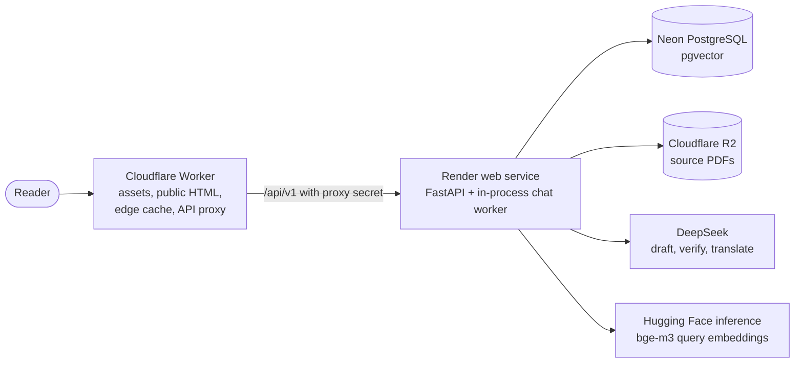

# Architecture

constitution.ng answers plain-language questions about Nigerian law from a
published, versioned corpus of the Constitution and federal statutes. The model
explains provisions it is given; it never decides what the law is. Every answer
block cites stored provisions, citations are generated by the server, and an
answer that cannot be tied to its evidence is withheld.

This document describes the system as it is in this repository. Decisions with
alternatives that were considered are recorded in [`adr/`](adr/README.md).

## Components

| Component | Code | Runs as |
| --- | --- | --- |
| API | `backend/app/api/`, `backend/app/main.py` | FastAPI. On Render, `backend/app/deployment/render_app.py` wraps it with the chat worker in one process. |
| Legal domain | `backend/app/legal/` | Library: references, parsers, evidence assembly, public corpus reads, topic guide. |
| Chat | `backend/app/chat/` | Generation worker, validation, translation, spend ledger, SSE events. |
| Ingestion | `backend/app/ingestion/`, `services/ingestion-worker/` | Separate worker process with Poppler and Tesseract for PDF rendering and OCR. Not part of the public runtime. |
| Reader languages | `backend/app/languages/` | Language detection, normalisation and per-language glossaries. |
| Frontend | `frontend/src/` | React, TypeScript, Vite, TanStack Router and Query, typed i18n catalogues. |
| Edge | `deployment/cloudflare/` | Cloudflare Worker: static assets, server-rendered public pages, API proxy, edge cache for public reads. |
| Database | PostgreSQL 18 with `pgvector` and `btree_gist` | Corpus, retrieval index, conversations, runs, events, spend ledger, accounts. |
| Object storage | `backend/app/ingestion/r2_blob_store.py` | Cloudflare R2 (or a local directory) for source PDFs and ingestion artifacts. |

The backend is a modular monolith: one Python package, one database, several
processes (API, chat worker, ingestion worker) that coordinate through
PostgreSQL rows, leases and `LISTEN/NOTIFY`, not through a message broker.

## Data model

Tables are defined in `backend/app/legal/models.py` (domain) and
`backend/app/models.py` (accounts). They fall into these areas.

**Legal corpus.** `LegalInstrument` (a constitution, Act or set of rules),
`SourceDocument` (an immutable source PDF with its SHA-256, authority, source
tier and verification status), `Provision` (a stable structural identity such
as `constitution-1999.chapter4.section37`) and `ProvisionVersion` (the text of a
provision for a validity period, with its legal status, source pages and text
hash). Identity and text are separate so that a provision can carry more than
one wording over time; an exclusion constraint stops two versions of one
provision from overlapping in time. `Amendment`, `AmendmentOperation`,
`ConstitutionalBill` and `LegislativeEvent` model alterations and proposals
separately from enacted text. The schema exists, but no amendment text is
ingested yet, so every published wording is the source edition's text.

**Ingestion and review.** `SourceUpload`, `IngestionRun`, `IngestionStep`,
`IngestionTask`, `IngestionEvent`, `IngestionArtifact`, `SourcePage`,
`ExtractionCandidate`, `CandidateRevision`, `ReviewIssue` and
`ReviewDecisionRecord`. Admin mutations carry an `expected_version` for
optimistic concurrency and an idempotency key (`IdempotencyRecord`). Events are
written with a `TransactionalOutbox` row in the same transaction.
`AdminRoleAssignment` and `AuditEvent` scope and record admin actions.

**Releases and retrieval.** `CorpusRelease` and `CorpusReleaseEntry` freeze the
set of provision versions that readers see. `RetrievalSegment` rows are derived
text for search; `RetrievalEmbedding` holds one 1,024-dimension vector per
segment for an `EmbeddingRun` of an `EmbeddingProfile`. `RetrievalIndexBuild`
ties a release to a validated build, and `ActiveRetrievalTarget` points readers
at the live one.

**Conversations and generation.** `Conversation` (owned by an account or a
guest session, pinned to a release and index build), `ConversationMessage`,
`MessageEvidence`, `GenerationRun`, `GenerationAdmission`, `GenerationEvent`
(the replayable SSE stream), `GenerationCapacity`, and the spend ledger:
`GenerationReservation`, `GenerationBudgetDay` and `GenerationBudgetMonth`.

**Accounts.** `User` (inherited from the template, extended with
`auth_version`), `RefreshToken`, `SavedProvision`, `UserPreferences` and
`RateLimitCounter`.

**Evaluation and terminology.** `EvaluationDataset`, `EvaluationItem`,
`LegalConcept` and `LegalConceptAlias`.

## Ingestion pipeline

Ingestion is an administrative workflow. Its stages are the values of
`IngestionStage` in `backend/app/legal/enums.py`:

1. **Upload and quarantine.** The browser uploads to a quarantine key. The API
   checks only object metadata and queues a run.
2. **Verify and scan.** The worker streams the object to a bounded temporary
   file and checks PDF magic bytes, SHA-256, size, encryption and a 1,000-page
   limit, then runs the configured malware scanner (`ingestion/malware.py`)
   while the object is still quarantined.
3. **Promote.** A clean file is stored content-addressed under
   `sources/sha256/<sha>/original.pdf`; an existing source with the same hash is
   reused. Canonical source objects have no delete path.
4. **Profile and select pages.** An admin confirms which pages belong to the
   instrument (covers, explanatory memoranda and subsidiary legislation are
   excluded).
5. **Extract.** Native text extraction (`ingestion/extraction.py`, `pdf.py`),
   with local Tesseract OCR (`ingestion/ocr.py`) or a managed OCR provider for
   pages without a usable text layer.
6. **Normalise and parse.** A versioned normaliser (`ingestion/normalization.py`)
   records the rules it applied. Pure parsers (`legal/parser.py` for the
   Constitution, `legal/act_parser.py` for Acts) build the hierarchy of parts,
   chapters, sections, subsections, paragraphs and schedules. A numbered line
   opens a section only when it is the next one expected, and the body must
   reconcile with the instrument's arrangement of sections; anomalies become
   review issues rather than guesses.
7. **Review.** Extraction candidates, revisions and blocking issues are resolved
   in the admin workspace against the source PDF. Revisions keep before/after
   snapshots and reasons.
8. **Materialise.** Approved candidates become `ProvisionVersion` rows. Acts are
   stored with historical, as-enacted semantics.
9. **Build retrieval documents, embed and index.** Embedding batches are
   checkpointed by a hash of profile, model revision and inputs; reused vectors
   must match both the retained artifact hash and PostgreSQL's float32 bytes
   (`ingestion/embedding_reuse.py`). An embedding run is selectable only if it
   pins a model revision and reaches Recall@10 of at least 0.95 on the
   instrument's benchmark (`ingestion/embedding.py`).
10. **Validate and publish.** Index validation checks row counts, hashes,
    dimensions and canonical joins. Publication locks the release, the active
    target and the run, and commits once
    (`ingestion/admin/release_publish.py`). A release needs a separate publisher
    and uploader.

The procedures, including formatting repair and the R2 lifecycle policy, are in
[`runbooks/ingestion.md`](runbooks/ingestion.md).

## Releases and editions

A release is immutable once published. Its statuses are `building`,
`validating`, `approved`, `production` and `retired`; one release is in
production at a time.

Each instrument is ingested as its own release. A **composite release**
(`ingestion/composition.py`) is the union of a production base and approved
member releases. It records each member's release, source hashes, parser
versions and edition notices, rejects conflicting versions of a provision,
unverified sources and open blocking issues, and reuses vectors whose retrieval
text and embedding-profile fingerprint are unchanged.

Conversations store the release and index build they started on, so an answer
in an existing conversation keeps citing the corpus it was written against after
a new release goes live. Public reads use the active target unless the request
names an earlier published release; draft releases return 404.

Every instrument carries an edition label. The Constitution text is a historical
source compilation (LFN 2004); Acts are labelled "as enacted, may have been
amended". Answers are not allowed to call historical text current law (see
[Answers](#answers)).

Production releases are built and reviewed locally, then copied to the
production database and activated with `deployment/publish_release.py`; see
[`runbooks/release.md`](runbooks/release.md).

## Retrieval

Exact citation lookup and semantic search share `backend/app/legal/evidence.py`.

**Exact lookup.** `legal/references.py` parses section, subsection and paragraph
references, lists and bounded ranges (expansion is capped at 20), with an
optional law qualifier such as "section 9 of the ACJA" or "ACJA s.9". A bare
reference means the Constitution. Lookup reads release entries and canonical
versions directly and needs no embedding provider. A missing provision is
reported as missing, never replaced by a semantic guess.

**Semantic search.** `semantic_lookup` runs three signals over the release's
segments (`ingestion/pgvector_repository.py`):

- dense: exact cosine distance over `pgvector` embeddings of the pinned
  embedding run (no approximate index; the corpus is a few thousand segments per
  instrument);
- lexical: PostgreSQL full-text search with the `simple` configuration;
- topic guide: `legal/topics.py` maps everyday and Pidgin-style phrasing to
  sections and adds companion sections (for example the Section 45 limits for
  Sections 37 to 41).

`fuse_rankings` combines them with weighted reciprocal-rank fusion
(`RETRIEVAL_RRF_K`, default 60; lexical weight `RETRIEVAL_LEXICAL_WEIGHT`,
default 0.15) and a flat boost for topic matches. In a release with several
laws it caps results per instrument and puts the matching Constitution right
first for rights questions. If the query embedding is unavailable or disabled,
search falls back to lexical plus topic signals and the response says so
(`retrieval_mode: "lexical"`).

Ranked segments are derived text. Every result is reloaded from
`ProvisionVersion` and its source before it is returned, and `evidence_item`
recomputes the hash of the served text and rejects a version whose stored hash
matches neither the served nor the normalised text.

## Answers

A question becomes a `GenerationRun`. The API admits it after per-guest and
per-account daily and one-minute limits and a global cap on admitted runs
(`api/routes/conversations.py`), and the chat worker processes it as a
sequence of typed stages (`chat/pipeline.py`). The cap
(`CHAT_MAX_ACTIVE_GENERATIONS`) is a queue depth: the worker generates
`CHAT_WORKER_CONCURRENCY` answers at once and claims the rest in the order
they arrived. While a run waits, its event stream sends `run.queued` with its
place among waiting runs (1 is next). The place is derived on each read, so it
carries no event ID and is not replayed. A question beyond the cap is refused
with HTTP 429.

1. **Understand the language.** A question that is not clearly English gets one
   budgeted call that returns its language and an English rendering
   (`chat/translation.py`). Retrieval and validation run on the English text.
2. **Prepare evidence.** `prepare_run` resolves exact references or runs
   semantic retrieval against the conversation's pinned release, adds context
   (parent sections, companions, application provisions) and trims the packet
   to `CHAT_EVIDENCE_MAX_CHARS`, dropping the lowest-ranked matches before
   context and never the best match. Source cards are sent to the client first.
   A question is treated as a follow-up only when it has no subject of its own
   (`chat/history.py`): a subsection or paragraph without a section, or no
   topic the guide recognises and fewer than three subject words once
   follow-up vocabulary ("explain", "more simply", "next section",
   "exceptions") is set aside. "Why?", "Explain that more simply" and "Tell me
   more" reuse the sections the previous answer cited, and a pronoun that could
   mean any of several cited sections gets a clarifying question. Any other
   question, including "How long can police detain me?" after an answer about
   Section 37, is retrieved as written; earlier turns reach the drafter only as
   conversation context.
3. **Draft.** The drafting call returns JSON blocks; each block lists the
   evidence IDs it relies on. The prompt version is
   `EXPLANATION_PROMPT_VERSION` in `chat/__init__.py`.
4. **Deterministic validation** (`chat/validation.py`). A block fails if it has
   no evidence or cites an ID that was not supplied, quotes wording that is not
   in its cited text, cites a section or names a law outside its evidence,
   describes how the answer was produced, calls historical text current law,
   or gives a link, email address or phone number that is not in its cited
   text. A failing first block rejects the answer; later failing blocks are
   dropped.
5. **Model verification.** A separate verifier call reviews each block against
   its evidence; `validate_verifier` rejects a missing or malformed verdict.
   One revision may carry the rejection reason back to the drafter. To limit
   what reader-written text can steer, the verifier receives the question and,
   for a follow-up, the question it follows, each capped at the 2,000-character
   admission limit, but not the conversation history.
6. **Translate.** For a non-English reader, the verified English answer is
   translated with a glossary slice, then checked deterministically (numbers,
   law names, list items, quotation marks, length ratio, still-English text).
   Yorùbá, Hausa and Igbo also go through a back-translation judge. Any failure
   returns the English answer.

The pipeline fails closed: a provider error, a schema error, a validation
failure or an exhausted budget ends the run with an explanation-unavailable
notice, and the reader still sees the source wording. Draft tokens are never
streamed; the answer is published only after both checks pass. Only the draft
stage's schema and grounding rejections are recorded as `validation_failed`.
Any other unexpected error is logged with its traceback and stored with
`failure_stage: "internal"` and its exception type, so a defect is not counted
as a grounding failure.

**Spend ledger** (`chat/budget.py`). Before every paid call the worst-case cost
is reserved against Lagos-day and month ledgers, serialised by a row lock, and
settled with the provider's reported usage afterwards. A call whose outcome is
uncertain stays reserved until it is reconciled. Limits come from
`CHAT_DAILY_BUDGET_USD`, `CHAT_MONTHLY_BUDGET_USD` and `AI_MONTHLY_BUDGET_USD`.
Rate limiting and server errors that the provider reports itself (HTTP 429, 500
and 503) are not charged. Such a call is retried once, after any `Retry-After`
pause of up to ten seconds. A response that is truncated or is not valid JSON
but reports its usage settles at that cost. Timeouts, transport errors and
gateway errors (502, 504) remain uncertain and are never retried.

**Durable runs and replay.** Runs are claimed with leases; a lease that expires
is recovered without repeating a call that may already have been charged.
Events are written to `GenerationEvent` before `pg_notify`, and the SSE endpoint
resumes from `Last-Event-ID`. `CHAT_GENERATION_KILL_SWITCH=true` stops new
explanations while lookup and reading continue.

**Cancellation and shutdown.** A reader's stop request is a flag on the run.
It is checked between stages and polled once a second while a provider call is
in flight; the call is then abandoned, its reservation is kept as possibly
charged, and the reader sees "You stopped this answer." A worker that is itself
stopped, for a deploy or restart, never reports that notice. A run that has
not dispatched a paid call goes back to the queue. One that may have been
charged is finished as stalled ("This answer took too long. Please try
again."), the same rule lease recovery applies after a crash.

## Reader languages

English, Nigerian Pidgin (`pcm`), Yorùbá (`yo`), Hausa (`ha`) and Igbo (`ig`)
are supported (`languages/codes.py`). The design is an English core with
translated edges: retrieval, drafting and both validation stages always run in
English, and only the question and the verified answer cross a language
boundary. Official wording is always shown in English. Glossaries
(`languages/data/glossary-*.json`), translated benchmarks and interface
catalogues are drafts that have not had native-speaker review, and non-English
answers are labelled Beta with a "Show English" toggle. The gates for removing
that label are in [`multilingual-evaluation-plan.md`](multilingual-evaluation-plan.md)
and [`reader-language-review-checklist.md`](reader-language-review-checklist.md).

## Public API

Public corpus reads are under `/api/v1/legal` (`api/routes/search.py`):

| Method | Path | Purpose |
| --- | --- | --- |
| POST | `/search` | Exact reference first, otherwise semantic search. |
| GET | `/releases/current` | Active release, edition and index identity. |
| GET | `/instruments` | Laws in the selected release. |
| GET | `/provisions/tree` | Ordered children of a path, or the whole tree. |
| GET | `/provisions/by-citation` | Exact citation lookup. |
| GET | `/provisions/{canonical_path}` | Canonical text, citation, source, ancestors and children. |
| GET | `/provision-history` | Versions of a provision across published releases. |
| GET | `/sources/{source_document_id}/content` | Original PDF, only if it belongs to the selected release. |

Reads accept `release_version`. Conversations, accounts and admin routes are in
`conversations.py`, `login.py`, `users.py`, `account.py` and `admin.py`. The
OpenAPI schema generates the frontend client in `frontend/src/client/`.

## Accounts and sessions

Accounts are optional; guests can ask questions and claim their conversations
after signing in. Access tokens are short-lived and kept in memory. The refresh
token is a rotating, `HttpOnly` cookie stored server-side only as a hash, with
family revocation on reuse and an `auth_version` counter that revokes access
tokens (`core/sessions.py`, `core/security.py`). In the browser, refreshes are
serialised across tabs with the Web Locks API and sign-out is broadcast over a
`BroadcastChannel` (`frontend/src/lib/session.ts`). Signup and recovery return
the same response whether or not an address is registered. The plan and its
open items are in [`plans/accounts.md`](plans/accounts.md).

## Deployment topology

- **Cloudflare Worker** (`deployment/cloudflare/worker.ts`). Serves the built
  frontend, renders public landing, law and provision pages as HTML
  (`public-pages.ts`), and forwards `/api/v1/` to the API with a shared secret.
  It forwards only to an allow-listed HTTPS origin, rejects encoded path
  separators, strips client forwarding headers, keeps SSE unbuffered, and
  caches only allow-listed public `GET` reads with cookies and authorisation
  removed.
- **Render** (`render.yaml`, `deployment/render/Dockerfile`). One free-plan web
  service running one ASGI process (`deployment/render/start.sh`). Incoming
  conversation requests wake the in-process worker; runs, leases, events and
  reservations survive restarts in PostgreSQL. The API rejects requests without
  the proxy secret (`backend/app/main.py`).
- **Neon** holds the database; **R2** holds source PDFs and backups.
- **Backups.** `deployment/render/backup-*.sh` take a `pg_dump` in a read-only,
  resource-capped container, compare inventories before and after, upload,
  read back and verify, and can restore into an isolated container. See
  [`runbooks/backup-restore.md`](runbooks/backup-restore.md).

`compose.yml` describes a self-hosted alternative with Traefik, the API, a
separate chat worker and the ingestion worker; it is used for local development
and browser tests. Production values are in `render.yaml`; the operating
procedures are in [`runbooks/render.md`](runbooks/render.md).

## Known gaps

- The published text is the source edition, not consolidated current law. The
  Constitution edition omits later alterations, and the Acts are as enacted.
- In the Constitution source, Section 168 is missing and two provisions are
  printed as Section 189; both are preserved as found.
- State laws, case law and amendment instruments are not ingested.
- Glossaries and non-English interface text have not had native-speaker review.
