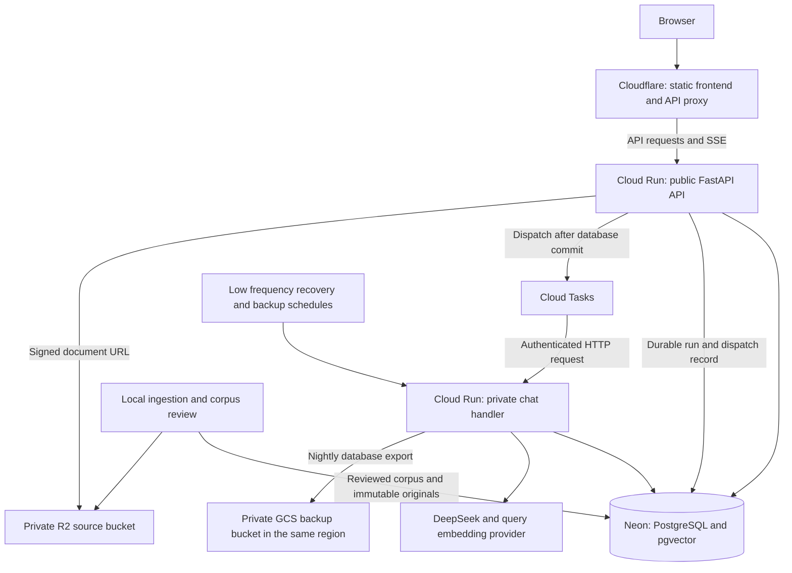

# Law Padi: deployment plan for a free hosting beta

## Current deployment

The initial backend now runs on Render Free because GCP billing activation
required an upfront payment. See [deployment status](deployment-status.md) and
[the Render runbook](../deployment/render/README.md), and
[the Cloudflare frontend runbook](../deployment/cloudflare/README.md). The existing
Worker is `constitition-ng`, so the current eventual free hostname is
`constitition-ng.amosgodwin500.workers.dev`. The GCP design below remains
an optional later migration path.

Prepared 14 October 2026. This is a deployment design, not an executed deployment. Provider limits were checked against official documentation on this date.

## Decision and agreed constraints

Use **Cloudflare Workers Static Assets + a small API proxy, GCP Cloud Run, Neon Free PostgreSQL, and Cloudflare R2**. Run chat generation through **Cloud Tasks**, so the worker consumes compute only when a question arrives. Keep ingestion as a local/on-demand administrative operation initially.

The user wants AI chat at the first public launch, a **$0 monthly hosting target**, a **$5 monthly AI ceiling**, and accepts a GCP billing card and a free third-party PostgreSQL service. Traffic is unknown. Assume an English beta, cold starts, conservative concurrency, and occasional quota-related unavailability. The initial browser-facing hostname is `constitution-ng.amosgodwin500.workers.dev`.

This can achieve free hosting for a small beta **when every service remains within its allowance**. It cannot guarantee free hosting until an unspecified level of “serious traffic.” Database active time, streamed responses, image storage, and network transfer can become billable before visitor counts look large. Paid AI must pause when its budget is exhausted. Hosting safeguards can also pause service rather than silently scale spending.

## What the repository actually needs

Read-only local inspection found:

| Component | Current state | Deployment implication |
| --- | --- | --- |
| Frontend | React/Vite, built into `backend/app/frontend` | Publish that directory as Cloudflare static assets. |
| API | FastAPI, Python 3.14, SQLModel/psycopg | Use a Linux container on Cloud Run. |
| Database | 51,967,679 bytes, approximately 50 MB | The initial database fits comfortably within Neon's storage allowance. |
| Retrieval | 1,829 stored vectors; pgvector 0.8.6 and btree_gist 1.8 | Keep PostgreSQL as the retrieval store; no separate Qdrant service is needed. |
| Chat worker | Separate process polling continuously | Add authenticated, bounded HTTP execution triggered by Cloud Tasks. |
| Streaming | Durable SSE events and PostgreSQL LISTEN | Keep replay, direct notification connections, and stream-preserving proxying. |
| Source documents | Originals in a persistent Docker volume | Transfer originals to R2; Cloud Run local files are temporary. |
| Container image | Approximately 2.17 GB uncompressed locally | Slim and measure the registry footprint before declaring image hosting free. |
| AI | DeepSeek generation plus verification; query embeddings via HF | Count both model calls, embedding calls, retries, and failed answers in the budget. |

Relevant implementation: `backend/Dockerfile`, `frontend/vite.config.ts`, `backend/app/core/db.py`, `backend/app/chat/{worker,events,budget}.py`, `backend/app/legal/evidence.py`, and `backend/app/api/routes/conversations.py`.

The current prompt is v8. The repository does **not** record a completed public quality gate for that prompt. Older v4 evaluation results are not v8 measurements. AI launch therefore includes completing the current 200-case evaluation and grounding review described in `docs/evidence-chat-rollout.md`, as well as verifying capacity for the deliberately small beta concurrency. Hosting readiness does not complete those checks.

## Proposed architecture

Cloudflare serves HTML, JavaScript, CSS, icons and other frontend assets. Only `/api/*` requests invoke the proxy Worker. Configure SPA fallback and `run_worker_first` specifically for API paths. All browser calls use the same origin: `https://<app>.workers.dev/api/...`, or the owned domain later. This avoids unreliable third-party anonymous-session cookies between `pages.dev` and `run.app`. Forward cookies, authorization, query strings and streamed response bodies; apply no caching to chat, account, admin or SSE responses. [Cloudflare routing configuration](https://developers.cloudflare.com/workers/static-assets/binding/)

The FastAPI API uses the generated `run.app` origin behind the proxy. A shared origin header can reject direct application access, but rejected requests still reach Cloud Run and can consume resources. Retain backend quotas and billing safeguards. Keep the task handler on a separate IAM-protected Cloud Run service; the proxy must never expose that handler. Tasks invoke it using a dedicated service account. [Cloud Run task integration](https://docs.cloud.google.com/run/docs/triggering/using-tasks)

Start with API, task queue and image registry in `us-east1`; choose a nearby Neon region available on Free. This is a cost/latency starting point, not a claim that Nigerian user data is stored in Nigeria. Measure response latency from Lagos before finalizing. Cloudflare accelerates frontend delivery; it does not move database or model work to Lagos.

## Free allowances and their limits

| Service | Current relevant allowance | Cost or availability condition |
| --- | --- | --- |
| Cloudflare Static Assets | Free, unlimited static asset requests | Runtime proxy requests have a separate quota. [Billing](https://developers.cloudflare.com/workers/static-assets/billing-and-limitations/) |
| Cloudflare Workers Free | 100,000 runtime requests/day; 10 ms CPU/invocation | Use a lightweight streaming proxy; network waiting differs from CPU work. [Limits](https://developers.cloudflare.com/workers/platform/limits/) |
| Cloud Run, request-based | 2 million requests/month; 180,000 vCPU-seconds; 360,000 GiB-seconds | Shared billing-account allowances; cold starts and open SSE requests consume resources. Region and transfer pricing also matter. [Pricing](https://cloud.google.com/run/pricing) |
| Neon Free | 1 GB/project; 100 CU-hours/month/project; 5 GB public transfer | Auto-suspends after five idle minutes; quota exhaustion can interrupt service. [Pricing](https://neon.com/pricing) |
| R2 Standard | 10 GB-month storage; 1 million Class A and 10 million Class B operations/month | Metered overages; Internet egress free. Use for immutable source documents. [Pricing](https://developers.cloudflare.com/r2/pricing/) |
| GCS Standard, private backups | 5 GB-month regional storage; 5,000 Class A and 50,000 Class B operations/month | Free storage applies in `us-east1`, `us-west1`, and `us-central1`; keep the bucket with the export runtime. [Free-tier conditions](https://docs.cloud.google.com/free/docs/free-cloud-features) |
| Cloud Tasks | First 1 million billable operations/month | Operations are not the same as completed answers; payload size and retries matter. Send run IDs, not full prompts. [Pricing](https://cloud.google.com/tasks/pricing) |
| Cloud Scheduler | First three jobs/month/billing account | The invoked worker/database still consumes its own allowance. [Pricing](https://cloud.google.com/scheduler/pricing) |
| Artifact Registry | 0.5 GiB of storage/billing account | All retained image versions count. Measure compressed registry storage and clean up old versions. [Pricing](https://cloud.google.com/artifact-registry/pricing) |
| Secret Manager | Six active secret versions and 10,000 accesses/month | Old enabled versions also count; size the secret setup deliberately. [Pricing](https://cloud.google.com/secret-manager/pricing) |

Neon supports `vector` and `btree_gist`; select PostgreSQL 18 and confirm available extension versions before restoring the current corpus. [Extensions](https://neon.com/docs/extensions/pg-extensions)

API traffic to Cloudflare, model providers, and an external database is still GCP network traffic. Cloud Run's outbound free allowance has geographic conditions; do not assume every transfer to Nigeria or another vendor is free. Keep frontend assets out of Cloud Run and redirect original-document downloads to R2. [Cloud Run networking prices](https://cloud.google.com/run/pricing)

For perspective, at 0.25 CU Neon's 100 CU-hours permit about 400 active hours/month. Five-minute suspend tails, monitoring queries and recovery jobs count toward active time. An unmodified constantly polling worker could keep it active all month and exceed Free even with no users. Avoid keep-alive pings and continuous database polling.

## Required implementation work

1. **Create a small production API/handler image.** Use a Python 3.14 slim base and production-only dependencies. Keep heavy PDF/ingestion tools in the ingestion image. Preserve imports that the API actually requires. Use one API process and a Cloud Run-compatible listening port. Do not bake secrets into images. Aim for total retained registry storage below 0.5 GiB, including a rollback version; measure rather than assume success. Retaining images beyond this limit means a small hosting bill before traffic.
2. **Add task-triggered generation.** Reuse `_claim_run(worker_id, run_id=...)` and `process_run(...)`, which already have a bounded execution path. Await completion within the HTTP request before returning success. Do not launch detached work after returning HTTP 200: request-based Cloud Run will not provide reliable background execution.
3. **Keep dispatch durable.** Commit the submitted message, generation run and chat dispatch outbox record atomically. Publish afterward using deterministic task names. Treat an already-created task as success. Filter the shared outbox by event type so chat dispatch never consumes ingestion events. Schedule a low-frequency recovery scan and also redispatch pending work during relevant user status/retry requests. Hourly recovery is a last safety net, not normal chat latency; it adds approximately 15 CU-hours/month at 0.25 CU if each wake keeps the DB active for five minutes.
4. **Handle redelivery and crashes.** Acknowledge terminal duplicates without generating again; do not reclaim an active lease. Use a new dispatch-attempt identifier when recovery legitimately requeues a run. Preserve the current rule that uncertain post-provider-dispatch crashes finish safely rather than blindly repeat model calls. Review the adapter's existing retry of uncertain charged requests; either stop such automatic retries or retain their reservations within the $5 budget. Exactly-once provider billing is not guaranteed.
5. **Make SSE work with suspension.** Initially use a direct Neon URL with a small SQLAlchemy pool. Transaction-pooled connections do not support LISTEN. If later separating pooled queries from notifications, add a dedicated direct listener URL. Stop the listener when no subscribers remain, reconnect after suspension, send heartbeats, and preserve replay with Last-Event-ID. [Pooling restrictions](https://neon.com/docs/connect/connection-pooling)
6. **Publish the frontend at one origin.** Build with `bun run --filter frontend build`; the existing output is `backend/app/frontend`, not `frontend/dist`. Use an empty/same-origin `VITE_API_URL` and the browser-facing URL as `FRONTEND_HOST`. Add the minimal Cloudflare proxy and SPA routing configuration. Ensure production does not set `FASTAPI_ENV=development`; current secure-cookie behavior depends on this. Do not pass the unsupported value `production` without changing the settings schema.
7. **Transfer the existing corpus and originals.** Export a fresh verified database snapshot, restore into a matching PostgreSQL version with supported extensions, and run only the remaining migrations. Preserve published release identities, active retrieval targets, 1,829 vectors, hashes and source metadata. Copy Docker-volume blobs into R2 preserving storage keys; changing an environment variable does not copy them. Verify original PDF access and release labels. Migrations and `prestart.sh` alone do not populate the Constitution.
8. **Configure the supporting flows.** Keep corpus ingestion off the public runtime initially. Run a nightly `pg_dump` export to a private GCS Standard bucket in the same region as Cloud Run, retain seven daily exports, and test a restore. Include the matching PostgreSQL client in the backup execution image and budget its registry storage. At the initial database size, seven exports fit comfortably below 5 GB. GCS encrypts stored objects by default; apply restricted bucket access. Keeping exports in-region avoids sending a full database through Cloud Run's Internet egress to R2 every night. [Default encryption](https://docs.cloud.google.com/storage/docs/encryption/default-keys) Configure an SMTP service within its free allowance if signup and recovery are included; provider/domain requirements must be checked when selected. Recovery currently expects email configuration.
9. **Complete the AI launch checks and deploy a versioned build.** Capture the intended changes from the currently modified working tree in a reviewed version. Existing workflows target FastAPI Cloud/Compose and must be replaced or supplemented. Use CI identity federation for GCP rather than a long-lived service-account key. Deploy via a manual release initially; automate after one verified release.

## Starting runtime limits

These are conservative beta settings to load-test, not measured capacity promises:

| Setting | Initial target |
| --- | --- |
| API Cloud Run | Request-based; min 0, max 2 instances; 1 vCPU; 512 MiB initially; one process; concurrency 8 |
| Chat handler Cloud Run | Request-based; min 0, max 1 instance; 1 vCPU; 512 MiB initially; concurrency 1 |
| Tasks | One concurrent dispatch; bounded retries; 300-second deadline, matched service timeout |
| Database pools | API 5, handler 2; add room for listener, migrations and backups |
| Generation admission | One active generation globally initially; explain temporary busy responses |
| Guest/account quotas | Proposed 3/10 questions/day, burst 1/2; global spend ceiling still applies |
| Recovery and backups | Two scheduled jobs total: hourly recovery and nightly backup/retention maintenance |

The handler's current generation bound is 120 seconds and its lease is 150 seconds. Verify cancellation of in-flight retrieval/provider work at timeout; threaded HTTP calls and retries must not outlive the lease and continue charging silently. Ensure queue and Cloud Run deadlines leave sufficient cold-start margin. HTTP Cloud Tasks allow deadlines up to 30 minutes. [Task timeouts](https://docs.cloud.google.com/tasks/docs/creating-http-target-tasks)

Memory must be measured with real requests. Raise it if necessary and recalculate allowance consumption. Instance limits control concurrency, not monthly spending: one continuously busy instance can exceed the free compute allowance.

## Enforcing the $5 monthly AI budget

Treat **generation + verification + embeddings + retries + live evaluation** as one AI budget. The existing daily ledger covers DeepSeek calls; it does not currently enforce a combined monthly cap or account for HF inference. Its default is **$100/day**, so explicit deployment values and additional budget handling are required.

Proposed split: **$4/month for generation and verification, $1/month for query embeddings**. This is an allocation, not a provider subscription. Confirm each provider's minimum credit purchase separately; cash top-ups can exceed a month's intended consumption if credits carry forward.

Before launch, add a shared monthly reservation ceiling of $5 in Lagos time and a controlled embedding allowance. Include public semantic search as well as chat in embedding limits; anonymous search can incur inference charges. Retain reservations for uncertain calls, reconcile provider usage, and stop before the ceiling rather than rely on delayed billing reports. A query cache must include embedding model/revision and normalized query identity; do not replace the embedding model against the existing index without rebuilding and evaluating it.

HF execution-time charges and timeout uncertainty mean an estimated application reservation alone cannot guarantee the $1 allocation. Require a dedicated prepaid/provider-enforced allowance without automatic recharge, or a confirmed bounded request price. If that cannot be configured within the user's cash budget, launch AI chat with the existing keyword/topic retrieval path and no paid query embeddings; evaluate that retrieval mode before public launch. Do not purchase credits beyond $5 just to satisfy a provider's minimum top-up.

As an additional conservative DeepSeek control, `CHAT_DAILY_BUDGET_USD=0.12` limits its configured ledger allowance to $3.72 in a 31-day month. This leaves room within the proposed $4 allocation; it does not itself cap embeddings or replace provider invoice reconciliation. Configure one generation at a time and peak token prices consistent with the actual model.

Confirm the HF endpoint's billing type. Serverless inference charges per use; dedicated endpoints charge for running hardware and are unsuitable for a $1 monthly allocation unless the measured usage fits. Current HF Free accounts have no included Inference Providers credits. [Serverless billing](https://huggingface.co/docs/inference-providers/pricing), [dedicated endpoint pricing](https://huggingface.co/docs/inference-endpoints/pricing)

Use prepaid/provider ceilings where available, with automatic recharge disabled. DeepSeek returns an insufficient-balance error when credit runs out. Application limits remain necessary if an existing provider account contains other funds. [DeepSeek errors](https://api-docs.deepseek.com/quick_start/error_codes/)

When the embedding allowance is exhausted, use the existing disclosed keyword/topic fallback. When generation funds are exhausted, pause new paid explanations and keep provisions available. Do not silently exceed $5 to preserve unlimited chat. If an answer costs an illustrative $0.01 or $0.02 across providers, $5 funds about 500 or 250 answers/month; this is scenario arithmetic, not a measured cost forecast.

## Hosting spending safeguards

Use a dedicated GCP project. Avoid Cloud SQL, load balancers, Cloud NAT, a Serverless VPC connector, GKE, always-on worker pools and minimum instances for this beta. Set instance limits, image cleanup, limited logs, small task payloads, and R2 retention. Cache only eligible public corpus reads; never cache private conversation/account data.

Keep secrets within the six-active-version allowance by mounting a packed runtime configuration secret for each service, with a small explicit settings-loader change for the mounted path. Database credentials, signing/bootstrap passwords, provider tokens, R2 credentials, the origin header and optional SMTP password otherwise exceed six individual versions. Grant each runtime access only to its needed bundle, and disable superseded versions after rotation. The current settings still require `FIRST_SUPERUSER_PASSWORD` at import; account for it even after bootstrap. Keep the proxy's matching origin header in a Cloudflare Worker secret. [Cloud Run secret mounting](https://docs.cloud.google.com/run/docs/configuring/services/secrets)

Set project-wide alerts at small net-spend levels, and configure the currently supported **Cloud Run spend-cap budget**. Its threshold uses gross estimated cost, excluding savings/credits, so a tiny cap can pause free-tier usage before a payable bill appears. Choose the gross threshold against the intended free-allowance workload rather than assuming a $0 target means a $0 cap. Enforcement is delayed and overages remain payable. It covers the selected project/service, not the whole stack: Tasks, registry storage, secrets and R2 require separate controls. [Spend-cap behavior and limitations](https://docs.cloud.google.com/billing/docs/how-to/budgets-spend-caps)

Cloudflare R2 budget alerts do not halt usage. Its free allowance is therefore a cost target with metered exposure, not an enforced $0 ceiling. Use a private source bucket, signed links, bounded retention and operation monitoring. [Cloudflare budget alerts](https://developers.cloudflare.com/billing/manage/budget-alerts/)

Add application abuse protection before enabling anonymous paid generation: global spend admission, per-session/account quotas, and IP-aware limits. Use Turnstile when practical and validate it server-side; bot checks supplement the budget controls. [Turnstile Free](https://developers.cloudflare.com/turnstile/plans/)

## Why the alternatives are less suitable

| Option | Assessment |
| --- | --- |
| Entire application on Cloudflare | Python/FastAPI Workers exist, but this Python 3.14/native PostgreSQL stack is not a drop-in deployment. Adapting it offers little benefit now. Containers require Workers Paid, starting at $5/month. [Python packages](https://developers.cloudflare.com/workers/languages/python/packages/), [Containers pricing](https://developers.cloudflare.com/containers/platform/pricing/) |
| GCP only, with Cloud SQL | Cloud SQL has paid ongoing resources and temporary trials, rather than a permanent free PostgreSQL tier for this plan. [Cloud SQL pricing](https://cloud.google.com/sql/pricing) |
| GCP free e2-micro VM + Compose | Eligible compute and 30 GB standard disk are free in three US regions, but ordinary external IPv4 costs $0.005/hour—about $3.65/month before transfer. Small RAM and operating/backing up PostgreSQL add constraints. IPv6-only networking needs provider-connectivity checks and is not the default recommendation. [GCP free conditions](https://docs.cloud.google.com/free/docs/free-cloud-features), [network charges](https://cloud.google.com/vpc/network-pricing) |
| Existing computer + Cloudflare Tunnel | Useful for a private pilot with the current processes; uptime depends on power, Internet and the host. Named Tunnel needs an owned domain. Quick Tunnel explicitly does not support SSE. [Named Tunnel setup](https://developers.cloudflare.com/tunnel/get-started/), [Quick Tunnel limits](https://developers.cloudflare.com/tunnel/get-started/quick-tunnels/) |
| Cloud Run serving the existing bundled frontend | A reasonable simpler pilot on one `run.app` URL. It avoids an edge proxy, but all frontend delivery consumes origin resources/transfer. Prefer it temporarily if the proxy delays readiness. |
| Supabase Free instead of Neon | Valid PostgreSQL alternative, with 500 MB database allowance; low activity can cause pausing after seven days. Neon is the preferred starting point for this intermittent runtime. [Pricing](https://supabase.com/pricing), [pausing](https://supabase.com/docs/guides/platform/free-project-pausing) |

GCP trial credits can pay for setup experiments, but the long-term design should remain within recurring allowances after credits expire. Domain registration/renewal is separate; use the existing domain if owned or the free platform hostname initially.

## Release sequence and acceptance checks

1. **Prepare:** slim image, add task execution/outbox recovery, add monthly AI/embedding controls, configure same-origin proxy and backups. No production switch yet.
2. **Validate privately:** evaluate the current prompt, inspect grounding, run a small capped provider probe, and test task redelivery, a lost enqueue, worker interruption, SSE disconnect/replay, and budget exhaustion. Include this paid validation in the agreed $5 budget unless separately authorized.
3. **Provision and transfer:** create the isolated project/database/buckets, restore the corpus, compare hashes/counts, run remaining migrations, create production secrets and verify a backup restore. Confirm the rendered edition caveat and known missing/ambiguous source cases remain accurate.
4. **Deploy:** deploy the IAM-private handler, queue and schedules, then API and Cloudflare frontend. Check deep links, anonymous sessions, login, email recovery, source PDFs, exact/semantic search and AI answers through the final public hostname. Verify browser security/cookie behavior and immediate SSE delivery.
5. **Open the beta:** enable generation only after quality, provider capacity, spend admission and transport checks pass. AI chat is included at this public launch; it is not deferred to a later public release under the user's chosen scope.
6. **Observe:** inspect costs, DB active hours, storage growth and real answer spend daily during the first week. Keep operational review low-frequency so monitoring does not prevent database suspension.

For implementation changes, run the frontend build, relevant backend tests/lint, and browser flows against a dedicated `_test` database. Never run destructive test fixtures against the published corpus. Validate deployed memory, cold starts and compressed image size before claiming the hosting target has been met.

## When to start paying

Upgrade based on measured resource consumption and user experience, rather than an arbitrary visitor count. Review when projected consumption reaches 70–80% of any allowance, AI funds run out too early, or cold starts/busy responses make the product difficult to use. Suggested review points: Neon storage around 0.7 GB, compute around 70 CU-hours/month, and Cloud Run CPU around 126,000 vCPU-seconds/month. Registry storage needs this review before the first release.

For a rough compute illustration, assume each question keeps a 1-vCPU API SSE request and a separate 1-vCPU handler active for 30 seconds each, without overlapping requests:

| Questions/day | Monthly questions, 30 days | Combined vCPU-seconds |
| --- | --- | --- |
| 20 | 600 | 36,000 |
| 100 | 3,000 | 180,000 |
| 300 | 9,000 | 540,000 |

These are planning assumptions. Ordinary API traffic, startup, retries and scheduled work add usage; concurrent requests can share API instance time. At about 100 questions/day under this scenario, free CPU is already consumed despite being far below two million requests. The $5 AI ceiling may bind much earlier.

The first paid upgrade should address the measured limit: more AI allowance, a paid Neon plan with sufficient compute/recovery, or Cloud Run capacity/warm instances. Keep the same container, SQL schema, R2 storage and edge frontend. This architecture can grow without migrating the whole application.
